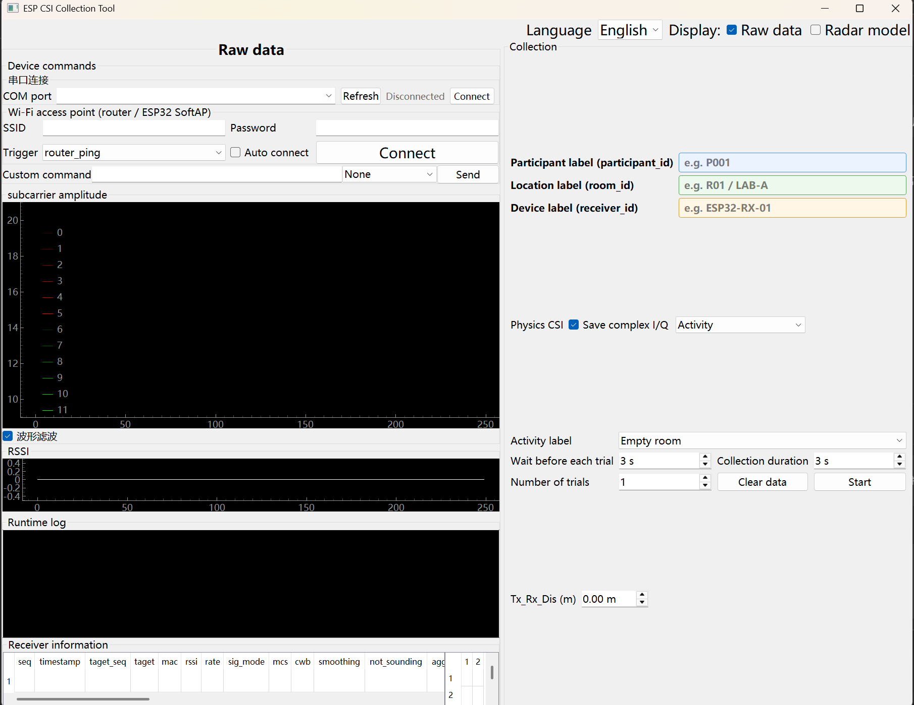

# CSI-Collect-Console

[English](README.md) · [研究采集设计](RESEARCH_CAPTURE.md) · [采集质量](tools/COLLECTION_QUALITY.md) · [复数 I/Q 物理采集](PHYSICS_CSI_CAPTURE_CN.md) · [数据格式详解](tools/data/README.md)

`CSI-Collect-Console` 是面向 AI、ISAC 和 ISCC 实验的 ESP32-S3 Wi-Fi CSI 采集系统，包括：

- 普通 Wi-Fi 路由器（AI 主实验默认）或可选 ESP-NOW 研究发射端 `csi_send`；
- 仓库根目录下的 CSI 接收与串口遥测固件；
- PyQt5 桌面采集工具 `tools/esp_csi_tool.py`；
- 中英文界面、参数记忆、等待/采集双倒计时和规范化实验元数据；
- 可运行时切换 `router_ping` 与 `null_data`，切换触发方式不需要重新烧录接收端；
- 可选的 ESP32-S3 SoftAP 发射端，使用现有 SSID/密码输入框即可切换；
- 按地点和日期归档的 CSV、逐记录 sidecar、日清单及目标链路质量门禁。

历史数据清洗与基准结果位于 [Leakage-Aware Selective Learning for Resource-Constrained Wi-Fi CSI Fall Detection](https://github.com/lixb123/Leakage-Aware-Selective-Learning-for-Resource-Constrained-Wi-Fi-CSI-Fall-Detection)。本仓库负责采集。历史发布使用 `wave/move/static/none/front/after` 旧标签，新采集的细粒度动作必须显式映射。

## 环境和设备

- 默认采集使用一块 ESP32-S3 接收板与固定路由器；研究发射板可选；
- 接收端 USB/UART 使用 2,000,000 波特率；可选发射板需要第二路连接；
- ESP-IDF 5.5.5；依赖锁定的 `esp-radar` 至少要求 ESP-IDF 5.4；
- Python 3.10+，依赖见 `tools/requirements.txt`。

ESP-NOW 研究模式使用源 MAC `1a:00:00:00:00:00` 和默认信道 11；使用此模式时两端信道必须一致。

接收端通过[仓库内固定的 esp-radar 0.3.4 补丁](vendor/esp-radar/PATCHES.md)保留 `rx_seq` 与已验证的 ACK 过滤行为；该目录保留上游许可证。

## 克隆项目

```powershell
git clone https://github.com/lixb123/CSI-Collect-Console.git
cd CSI-Collect-Console
```

编译前请打开 ESP-IDF 5.5.5 终端。

## 可选：编译并烧录研究发射端

以 AI 方法为重点时可跳过本节，直接使用固定的普通路由器；复数 I/Q 由接收端采集，不要求 ESP32 发射端。只有需要 ISAC/ISCC 包标记和发送端遥测时才烧录 `csi_send`。

```powershell
cd csi_send
idf.py -B build-research-s3 set-target esp32s3
idf.py -B build-research-s3 build
idf.py -B build-research-s3 -p COM_TX flash monitor
```

把 `COM_TX` 替换为发射端 UART 端口。上述命令编译默认 SoftAP profile，适用于路由器连接采集。使用 ESP-NOW 研究发射端时，先编译并烧录专用 profile：

```powershell
idf.py -B build-espnow -D IDF_TARGET=esp32s3 -D SDKCONFIG=sdkconfig.espnow -D SDKCONFIG_DEFAULTS="sdkconfig.defaults;sdkconfig.espnow.defaults" build
idf.py -B build-espnow -p COM_TX flash monitor
```

然后在 ESP-NOW 发射端 monitor 中配置 session 实验 ID：

```text
research_tx --stop
research_tx --experiment_id P001-R01-D01-S01 --interval_ms 10 --payload_length 32 --reset_counters
research_tx --start
research_tx --status
```

实验 ID 必须与接收端实验 JSON 中的 `transmitter_experiment_id` 一致。协议字段及计数口径见 [csi_send/README.md](csi_send/README.md)。

## 编译并烧录接收端

回到仓库根目录：

```powershell
idf.py -B build-research-rx set-target esp32s3
idf.py -B build-research-rx build
idf.py -B build-research-rx -p COM_RX flash
```

把 `COM_RX` 替换为接收端 UART 端口。运行 GUI 前关闭占用同一串口的 `idf.py monitor`。

ESP-NOW 需要从仓库根目录编译并烧录匹配的接收端 profile：

```powershell
idf.py -B build-rx-espnow -D IDF_TARGET=esp32s3 -D SDKCONFIG=sdkconfig.espnow -D SDKCONFIG_DEFAULTS="sdkconfig.defaults;sdkconfig.espnow.defaults" build
idf.py -B build-rx-espnow -p COM_RX flash
```

路由器和 ESP-NOW 对应不同固件镜像。ESP-NOW 采集前会核验接收模式与研究帧遥测。

如需烧录已有构建产物，应使用对应构建目录中的 `flasher_args.json`。不同固件 profile 的分区布局可能不同。构建目录不会上传到 GitHub，推荐在本机编译并使用 `idf.py flash`。

## 启动界面

```powershell
cd tools
python -m pip install -r requirements.txt
python esp_csi_tool.py
```

不指定串口时进入离线界面模式，可先设置布局和采集参数。连接接收端时运行：

```powershell
python esp_csi_tool.py -p COM_RX
```

默认界面使用 English、打开 Radar model，并关闭 Wi-Fi Auto connect。Collection 是独立区域：Activity 单独占一行，Raw data 与 Collection 默认各占一半宽度；取消 Radar model 后，Radar model 的标题和内容一起隐藏，Collection 采集控件仍可用。界面说明、曲线颜色、单位和现场操作步骤见 [tools/GUI使用说明_CN.md](tools/GUI使用说明_CN.md)。



截图展示了实际采集界面：Raw data 与 Collection 位于上方并列区域，Activity 在 Collection 中独占一行，Radar model 位于下方并可整体隐藏。

触发方式可以在运行时切换：

- `router_ping`：适用于普通路由器和 ESP32-S3 SoftAP，兼容性最广；
- `null_data`：由接收端发送 802.11 Null Data 帧，保留用于连接诊断；正式采集默认被拦截，需验证目标 AP 来源并显式启用 `allow_null_data_collection`。

同一个 session 内应保持一种触发方式。切换后请新建 session，并重新采集空房和静止人员参考。串口等效命令为 `radar --send_mode router_ping` 和 `radar --send_mode null_data`。

专用 SoftAP 发射端的编译、烧录和连接步骤见 [ESP32S3_SOFTAP_CSI_GUIDE_CN.md](ESP32S3_SOFTAP_CSI_GUIDE_CN.md)。接收端 GUI 不需要新增控件：先断开连接，填写 SoftAP 的 SSID 和 WPA2 密码，再使用原有 Wi-Fi 连接按钮。

需要研究级元数据、manifest 和 sidecar 时：

```powershell
Copy-Item config\experiment_config.example.json config\experiment_config.json
# 编辑复制出的文件后：
python esp_csi_tool.py -p COM_RX `
  --csi_output_type LLTF `
  --experiment-config config\experiment_config.json `
  --data-root data
```

人员字段请使用 `P001` 等匿名编号，不要填写姓名、手机号或学号。界面会记忆语言、人员、地点、动作、等待时间、采集时长和次数。个人配置可能包含 Wi-Fi 密码，因此不会提交到 GitHub。

## 采集流程

1. 确认接收端连接目标 AP；使用 ESP-NOW 时核对 TX/RX 信道和实验 ID；
2. 填写人员、地点、接收设备标签和 Tx-Rx 距离（m）；
3. 选择动作；中英文切换只改变显示，不改变英文机器标签；
4. 设置每次等待、采集时长和次数；串口设备变化后点击 Serial Refresh 重新扫描端口；
5. 点击开始，每轮执行“等待倒计时 → 采集倒计时”，然后重复；
6. 动作采集前核对目标 MAC、目标帧率、模式稳定时间和人员站立静止基线；采集后检查每条质量状态并在训练前校验 manifest。

输出示例：

```text
tools/data/
└── R01/
    └── 2026-09-01/
        ├── 14-32-08-125_R01_P001_fall_forward_1.csv
        ├── 14-32-08-125_R01_P001_fall_forward_1.meta.json
        └── session_manifest.csv
```

CSV 内含 PC 时间、接收端单调时间、射频字段和解码后的 CSI 字节。每种文件用途、字段解释、标签体系和 Python 读取示例见 [tools/data/README.md](tools/data/README.md)。

## 校验及下游处理

```powershell
cd tools
python validate_session.py data\R01\2026-09-01
python validate_all_sessions.py data
python export_training_data.py data\R01\2026-09-01
```

同一地点同一天的 manifest 可以索引多个 session。使用 `validate_session.py --session-id` 检查指定 session。训练导出仅保留完成且通过质量、目标来源检查的记录，不修改原始 CSV。补采标准见[采集质量说明](tools/COLLECTION_QUALITY.md)。

清洗和模型基准请继续使用：

- [会议文章数据处理仓库](https://github.com/lixb123/Leakage-Aware-Selective-Learning-for-Resource-Constrained-Wi-Fi-CSI-Fall-Detection)

## 公开仓库范围

Git 会排除构建目录、managed components、运行日志、CSI 数据和个人配置。可复制 `tools/config/gui_config.example.json` 预先建立本地配置；如果不复制，GUI 首次运行会自动生成 `gui_config.json`。

## 许可证

项目特有代码和文档使用 MIT License。ESP-IDF、Espressif 示例代码及 managed components 仍遵循各自的上游许可证与声明。
